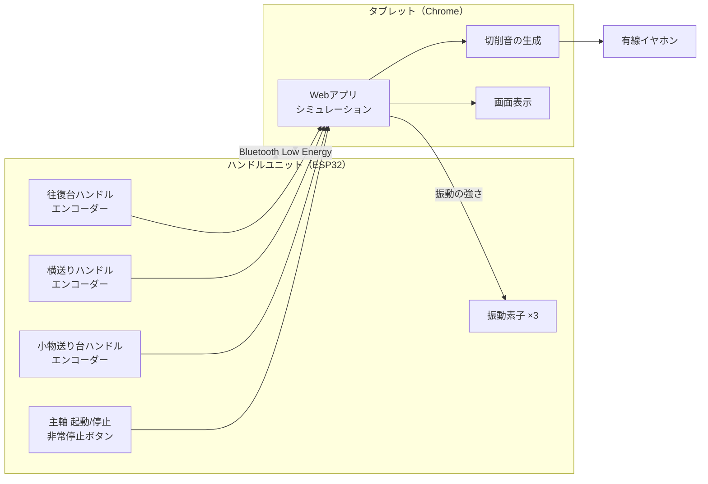
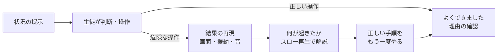

# バーチャル旋盤 企画書・設計書

> 旋盤に触れる前に、「何が危ないのか」と「基本の動かし方」を安全に体で覚えるための教材

| 項目 | 内容 |
|---|---|
| 対象 | 旋盤未経験の生徒（工業高校1年生・航空機械科を想定） |
| 使う場面 | 実機実習の前の導入授業（1コマ50分） |
| 構成 | 3軸ハンドルユニット（ESP32）＋ 生徒用端末（Chromebook / Android）＋ 有線イヤホン |
| 台数 | 5〜10台（1台を2〜4人で使う） |
| 初版の範囲 | ① 基本操作練習モード ② 危険体験モード |
| 版 | 第2版（学校の旋盤の目盛り値を反映） |

---

## 1. 目的

### 1.1 背景
- 旋盤は「回転する工作物」と「刃物」を扱うため、初心者の事故（巻き込まれ・飛来物・切りくずによる切り傷）が起こりやすい。
- 実機では危険な状況を **わざと体験させることはできない**。そのため、口頭や動画の説明だけでは「なぜダメなのか」が実感として残りにくい。
- また、初めての実機ではハンドルの回し方・目盛りの読み方に気を取られ、周囲の安全確認まで意識が回らない。

### 1.2 ねらい
1. **危険を安全に疑似体験する**：画面・振動・音で「やってはいけないこと」をした結果を体感し、理由とセットで覚える。
2. **基本操作を先に身につける**：縦送り・横送りハンドルの操作、目盛りの読み方、切込み量と仕上がりの関係を、材料と時間を気にせず何度でも練習する。
3. **実機での最初の1時間を安全にする**：手順が体に入った状態で実機に移る。

### 1.3 実機ではなくバーチャルにする意味
| | 実機 | バーチャル旋盤 |
|---|---|---|
| 危険な操作の体験 | できない | 何度でもできる |
| 材料・工具の消耗 | あり | なし |
| 一度に練習できる人数 | 台数で制限 | タブレットの台数分 |
| 失敗のやり直し | 材料交換が必要 | ボタン1つ |
| 切削の手応え・本物の感覚 | ◎ | △（振動と音で近づける） |

※ 実機の代わりではなく、**実機の前段階** という位置づけ。

---

## 2. 全体構成



- **ソフトはWebアプリ**（Chrome の Web Bluetooth 機能で ESP32 とつなぐ）。アプリストアからのインストールは不要。学校の生徒用端末（Chromebook / Android）をそのまま使う。
  - iPad の Safari は Web Bluetooth に対応していないので、端末の種類を事前に確認する。
  - Web Bluetooth は HTTPS で配信されたページでのみ動くため、GitHub Pages などで公開する。
  - 一度読み込めば授業中は通信なしで動くように作る（PWA化）。
- **計算はすべてタブレット側**で行い、ESP32 は「ハンドルの回転量を送る」「言われた強さで振動する」だけにする。こうするとマイコンのプログラムが単純になり、教材内容の変更はWeb側だけで済む。

---

## 3. ハードウェア

### 3.1 ハンドルユニットの外観イメージ

```
   ┌──────────────────────────────────────────────┐
   │ [非常停止]                  [主軸 起動] [停止] │
   │                                                │
   │                    ◎ 小物送り台ハンドル（0.02） │
   │                      （刃物台の微動：Z方向）     │
   │                                                │
   │  ◎ 往復台の大ハンドル     ◎ 横送りハンドル（0.05DIA）│
   │   （縦送り：Z方向）        （X方向）               │
   │   ラベル：VL-01                                 │
   └──────────────────────────────────────────────┘
        ↑ 振動素子は各ハンドルの軸受けの近くに固定
```

- ハンドルの配置は学校の旋盤と同じにする（左に往復台の大ハンドル、右手前に横送り、その奥に小物送り台）。実機に移ったときに迷わないようにするため。
- ハンドルの形も実機に合わせる。横送りと小物送り台は二つ玉のクランクハンドル、往復台は大きなハンドル車にする。旋盤用の市販のハンドル部品を使うと、握った感じが実機に近くなる。
- **ダイヤル環は実機と同じ数字・目盛り・表記にする**（横送りの「0.05DIA」、小物送り台の「0.02」など）。3Dプリントして目盛りを刻印するか、シールを貼る。画面のダイヤル表示とも一致させる。
- 実機のハンドルにはクリック感がないので、**クリックのない光学式エンコーダー**を使う。フェルトやOリングで軽いブレーキをかけ、回すときの重さを実機に近づける。
- ハンドルの軸はベアリングで支え、エンコーダーとはフレキシブルカップリングでつなぐ。生徒が強く握っても、エンコーダーの軸に力がかからないようにするため。

### 3.2 部品表（概算）

予算は確保済みなので、**本物に近い操作感と、10台を何年も使える丈夫さ**を優先する。

| 部品 | 例 | 1台の数 | 1台分の概算 | メモ |
|---|---|---|---|---|
| マイコン | ESP32 開発ボード（ESP32-DevKitC 等） | 1 | 1,500円 | Bluetooth内蔵 |
| エンコーダー（標準） | 光学式インクリメンタル 600P/R（LPD3806-600BM 等） | 3 | 6,000円 | オープンコレクタ出力 |
| エンコーダー（高耐久） | オムロン E6B2-CWZ6C 600P/R 等 | 3 | 45,000円 | 授業で長く使うならこちら |
| 振動素子 | LRA（リニア振動アクチュエータ） | 3 | 1,500円 | 鋭い振動から連続振動まで出せる |
| 振動ドライバ | DRV2605L 基板 | 3 | 4,500円 | 振動パターンを内蔵している |
| I2C 切替器 | TCA9548A 基板 | 1 | 1,000円 | DRV2605L はアドレスが固定なので、3つつなぐのに使う |
| （オプション）体感振動 | 振動トランスデューサー＋小型アンプ（MAX98357A 等） | 1 | 4,000円 | 台座全体を震わせて、機械の振動を出す |
| ハンドル部品 | 旋盤用ボールハンドル ×2、ハンドル車 ×1 | 3 | 10,000円 | 市販品か3Dプリント |
| 軸まわり | ベアリング、シャフト、フレキシブルカップリング | 3組 | 3,000円 | |
| 押しボタン | 非常停止（キノコ形）、起動（緑）、停止（赤） | 3 | 2,500円 | 実機と同じ色にする |
| 電源 | USBモバイルバッテリー | 1 | 2,000円 | |
| 筐体 | アルミフレーム＋板（または厚手のMDF） | 一式 | 5,000円 | 重くして、ハンドルを回しても動かないようにする |
| **1台の合計** | | | **標準 約4万円 / 高耐久 約8万円** | タブレットは生徒用端末を使う |
| **10台の合計** | 予備部品を1割足す | | **標準 約45万円 / 高耐久 約90万円** | |

※ 値段は目安。購入時に見積もりを取る。

**注意点**
- 600P/R のエンコーダーは 5V〜24V 電源のオープンコレクタ出力のものが多い。出力は **ESP32 側の 3.3V にプルアップ** して使う（5Vにプルアップすると ESP32 が壊れる）。
- 600P/R を4逓倍で読むと、1回転2400カウントになる。小物送り台の 0.02mm の目盛り（1回転を仮に150目盛りとする）でも、1目盛りあたり16カウントあるので十分細かい。
- 振動素子を ESP32 のピンに直接つながない。必ずドライバ（DRV2605L）を通す。

### 3.3 ピン割り当て（案）

| 機能 | ESP32 ピン | 備考 |
|---|---|---|
| 往復台 エンコーダー A / B | GPIO 32 / 33 | ハードウェアのパルスカウンター（PCNT）で数える |
| 横送り エンコーダー A / B | GPIO 25 / 26 | 同上 |
| 小物送り台 エンコーダー A / B | GPIO 34 / 35 | 入力専用ピンで内部プルアップがないため、外付けの抵抗で 3.3V にプルアップする |
| I2C（振動ドライバ用） SDA / SCL | GPIO 21 / 22 | TCA9548A を通して DRV2605L を3つつなぐ |
| 主軸 起動ボタン | GPIO 18 | 内部プルアップ、押すとLOW |
| 主軸 停止ボタン | GPIO 19 | 同上 |
| 非常停止ボタン | GPIO 23 | **b接点（常時閉）** で配線し、断線しても「停止」側になるようにする |
| （オプション）体感振動アンプ I2S | 空きピン（例：GPIO 4 / 5 / 27） | 振動トランスデューサーを付ける場合 |
| 状態表示LED | GPIO 2 | 接続中は点灯 |

> 非常停止を b接点にするのは実機の考え方と同じ（フェールセーフ）。授業でもこの理由を説明できる。

---

## 4. 通信仕様（Bluetooth Low Energy）

### 4.1 データの流れ

| 方向 | 内容 | 周期 |
|---|---|---|
| ESP32 → タブレット | 往復台・横送り・小物送り台のカウント値、ボタンの状態 | 50回/秒（20ms ごと）、変化があったとき |
| タブレット → ESP32 | 振動の強さ（0〜255）、振動パターン、持続時間 | 必要なとき |

### 4.2 データ形式（案）

**ハンドル状態（ESP32 → タブレット、Notify、14バイト）**

| バイト | 内容 |
|---|---|
| 0–3 | 往復台カウント（符号付き32bit） |
| 4–7 | 横送りカウント（符号付き32bit） |
| 8–11 | 小物送り台カウント（符号付き32bit） |
| 12 | ボタン状態（bit0: 起動, bit1: 停止, bit2: 非常停止） |
| 13 | 通し番号（取りこぼし検出用） |

**振動指令（タブレット → ESP32、Write、5バイト）**

| バイト | 内容 |
|---|---|
| 0 | 対象（0: すべて, 1: 往復台, 2: 横送り, 3: 小物送り台, 4: 台座） |
| 1 | 強さ 0〜255 |
| 2 | パターン（0: 連続, 1: 細かい振動＝びびり, 2: 一発の衝撃, 3: 脈動） |
| 3–4 | 持続時間 ms（0 = 次の指令まで） |

### 4.3 ESP32 側の安全処理
- **0.5秒間指令が来なければ振動を止める**（通信が切れたときに振動しっぱなしにしない）。
- 振動の連続時間に上限（例：最大3秒）を設け、ESP32 側でも強制的に止める。
- 非常停止ボタンが押されたら、タブレットの指令に関係なく振動を止める。

### 4.4 遅延の目標
- ハンドルを回してから画面の工具が動くまで **50ms 以内**（人が「遅れている」と感じにくい範囲）。
- **イヤホンは有線を推奨**。Bluetooth イヤホンは 0.1〜0.3秒程度の音の遅れが出るため、「削った瞬間の音」がずれて違和感になる。

---

## 5. シミュレーションの考え方

### 5.1 画面
- 旋盤を **真上から見た図**（2D）を基本にする。チャック・工作物・バイト・刃物台・心押し台を表示。
- 工作物は回転して見えるように表面に模様（縞）を流す。
- 画面右上に **目盛りダイヤル**（縦送り・横送り）と、**現在の直径・長さ** の数値を表示。
- 3D表示は後の拡張とし、初版は「軽く・確実に動く」ことを優先する。

### 5.2 工作物の表現
- 工作物を「長さ方向に 0.1mm ごとに区切った半径の配列」で持つ。
- バイトの刃先がある位置の半径より内側に入ったら、その分だけ半径を削る → 断面が刃先の形に削れていく。
- 削った量（体積）から切りくずの量を出し、画面に切りくずを飛ばす。

### 5.3 ハンドルと動きの対応（学校の旋盤の値）

| ハンドル | 動く方向 | 1目盛り | 1回転 | 目盛りの数字 |
|---|---|---|---|---|
| 往復台の大ハンドル | Z（縦送り・粗い） | 0.2mm | 22mm（110目盛り） | 実機の数字のとおり |
| 横送りハンドル | X（切込み） | **直径で 0.05mm**（刃先は半径で 0.025mm 動く） | 直径で 10mm（200目盛り） | 0, 0.5, 1 … 9.5（「0.05DIA」表記） |
| 小物送り台ハンドル | Z（細かい送り） | 0.02mm（実際に動く量） | **要確認**（仮に 3mm＝150目盛り） | 0, 0.5 … 2.5 |
| 主軸回転数 | — | — | — | 実機の回転数表の段数に合わせる（要確認） |

- 横送りの1回転の量は、写真のダイヤルの数字（0〜9.5）から読み取った値。
- 小物送り台は、初版では Z 方向と平行（0°）に固定する。角度を付けたテーパー削りは今後の拡張にする。
- どの値も設定画面で変えられるようにし、学校の旋盤が別の機種になっても合わせられるようにする。

> **初心者がつまずく点：「DIA」の意味**
> 横送りのダイヤルの「0.05DIA」は直径で読む目盛り。1目盛り回すと刃先は 0.025mm しか動かないが、工作物の直径は 0.05mm 小さくなる。
> 一方、小物送り台の「0.02」は刃先が実際に動く量。
> 同じ「1目盛り」でも意味が違うことを、練習モードで体験させる（6.2参照）。

### 5.4 切削の負荷 → 音と振動
授業でも扱う基本式をそのまま使う。

- 切削速度：**V = π × D × N / 1000**（m/min）　D：直径 mm、N：回転数 min⁻¹
- 主分力（切削抵抗）：**F = kc × ap × f**（N）　kc：比切削抵抗（例：軟鋼 約2000 N/mm²）、ap：切込み mm、f：送り mm/rev
- 切削動力：**P = F × V / 60000**（kW）

これを次のように使う：

| 計算結果 | 音 | 振動 |
|---|---|---|
| 回転数 N | 回転のうなり音の高さ | — |
| 切削中かどうか | 「シャー」という切削音が鳴る | 弱い連続振動 |
| 切削抵抗 F が大きい | 音が太く・大きくなる | 振動が強くなる |
| F が限界を超える（過負荷） | 「ギャー」という異音 | 強い不規則な振動 |
| 突き出しが長い＋切込み大 | 「ビー」というびびり音 | 細かい振動パターン |
| 衝突 | 「ガン」という衝撃音 | 一発の強い衝撃 |

音はタブレットのブラウザ機能（Web Audio）で **その場で合成** する（録音ファイルを用意しなくてよい）。将来、実機の切削音を録音して差し替えることもできる。

### 5.5 仕上げ面
- 送り f が大きいと画面上の削り跡（送りマーク）が粗く見える。
- 理論表面粗さ **Rmax ≈ f² / (8r)**（r：ノーズ半径）を表示し、「送りと仕上がりの関係」を数字でも見せる。

---

## 6. 基本操作練習モード

### 6.1 課題の流れ（易しい順）

| 段階 | 課題 | 覚えること | 合格の目安 |
|---|---|---|---|
| 1 | ハンドルに慣れる | 3つのハンドルの回す向きと工具の動く向き、目盛りの読み方 | 指示した位置へ工具を動かせる |
| 2 | 端面削り | 中心まで横送りで削る、中心高さの意味。小物送り台で削る量（0.02mm 単位）を決める | 端面を平らに削れる |
| 3 | 外径削り | 横送りで切込み → 往復台で縦送り → 戻す → 測る、の繰り返し | 目標直径 ±0.05mm（横送り1目盛り） |
| 4 | 段付き削り | 往復台で大まかに、小物送り台で細かく長さを合わせる。仕上げ代を残す考え方 | 直径 ±0.05mm、長さ ±0.02mm |
| 5 | 仕上げ削り | 送りを小さくすると面がきれいになる | 粗さの目標値以下 |

### 6.2 練習中の表示
- **目盛りの動き** を大きく表示し、「何目盛り回すと何mm削れるか」を体で覚えさせる。
  - 横送りの目盛りは **直径で読むか半径で読むか** をはっきり表示する（初心者がつまずく点）。
  - 例題：「直径 30.00mm を 29.00mm にするには、横送りを何目盛り回す？」→ 答えは 20目盛り（1.00 ÷ 0.05）。10目盛りと答えた生徒には、DIA の意味をもう一度説明する。
  - 例題：「段の長さをあと 0.3mm 長くするには、小物送り台を何目盛り回す？」→ 答えは 15目盛り（0.3 ÷ 0.02）。
- 「測定」ボタンで主軸を止めてから測る手順を必ず踏ませる（回転中は測定できない）。
- **バックラッシ**（ハンドルを逆に回したときの遊び）を設定でオン/オフでき、「目盛りは一方向から合わせる」理由を体験できる。

---

## 7. 危険体験モード

### 7.1 シナリオの基本の流れ



- 「危険な結果」を見せて終わりにせず、**必ず正しい手順をやり直してから終わる**。怖さだけが残らないようにする。
- 結果の場面は、いきなり強い演出にせず、後述の「演出の強さ」設定に従う。

### 7.2 シナリオ一覧（初版）

| # | シナリオ | 危険な操作 | 再現する結果 | 学ぶこと |
|---|---|---|---|---|
| 1 | チャックハンドルの置き忘れ | チャックハンドルを差したまま主軸起動ボタンを押す | ハンドルが飛ぶ演出、強い衝撃振動と衝撃音 | ハンドルはチャックから手を離すとき必ず抜く。起動前の指差し確認 |
| 2 | 手袋・袖の巻き込み | 手袋をした手（画面タッチ）を回転中の工作物に近づける | 画面が引き込まれる演出、断続的な強い振動 | 回転体の作業では手袋禁止（労働安全衛生規則 第111条）。袖口・髪・名札 |
| 3 | 切込みすぎ | 一度に大きく横送りして切り込む | ギャー音、激しい振動、バイトの刃先が欠ける | 切込み量と送りの限度。荒削りと仕上げの使い分け |
| 4 | 切りくずを素手で払う | 回転中に切りくず（画面タッチ）に触る | 手を切る警告演出 | 切りくずは主軸を止めてブラシ・切りくずかきで除く |
| 5 | 回転中の測定 | 回転中に「測定」を選ぶ | 測定具が持っていかれる演出 | 測定は必ず主軸を止めてから |
| 6 | 刃物台とチャックの衝突 | 縦送りでチャック側へ送りすぎる | 衝突音と一発の強い衝撃 | 送りすぎに注意。チャックとの距離を常に意識する |
| 7 | 保護メガネなし | 保護メガネを着けずに作業開始 | 切りくずが目の方向へ飛ぶ演出 | 始業時の服装・保護具の確認 |

- **画面へのタッチ ＝ 自分の手** として扱う。回転中に工作物やチャック付近を触ると反応する。これにより「つい手を出す」行動を体験できる。
- シナリオ1・6・7は「作業開始前の確認」として、毎回の練習の最初に組み込むこともできる。

### 7.3 主軸起動の手順を体に覚えさせる
主軸起動ボタンを押したときに、次の確認ができているかを判定する。

1. 保護メガネ・服装の確認（画面でチェック）
2. チャックハンドルを抜いた
3. 工作物の締め付けを確認した
4. バイトがチャック・工作物に当たらない位置にある
5. 周囲に人がいない（「よし」の声掛け → ボタンで代用）

確認が抜けていた場合は、その項目に対応する危険シナリオに入る。

---

## 8. 安全への配慮（教材そのものの安全）

| 項目 | 対策 |
|---|---|
| 耳への負担 | アプリ側で最大音量を制限する。衝撃音は「大きさ」ではなく「急に鳴る」ことで表現する。授業前に音量を確認 |
| 手への振動 | 振動の強さ・連続時間に上限（ESP32 側でも制限、4.3参照） |
| 驚きすぎ | 演出の強さを3段階（弱・中・強）で選べる。初回は「弱」から。事前に「何が起きるか」を伝えてから体験させる |
| 苦手な生徒への配慮 | 危険体験は見学（画面だけ）でも参加できる。衝撃的な表現（血など）は使わない |
| 授業の進行 | 教員が全員の画面を一時停止できる機能（拡張） |
| 実機との混同 | 「これはシミュレーションで、実機はもっと速く・強い」ことを必ず伝える。バーチャルで慣れて油断しないよう、最後に実機の動画や実演を見せる |

---

## 9. 授業での使い方

### 9.1 グループと役割
5〜10台を用意し、1台を2〜4人で使う。役割を決めて交代する。

| 役割 | すること |
|---|---|
| 操作係 | ハンドルとボタンを操作する |
| 確認係 | 主軸を起動する前に、確認項目（7.3）を声に出して読み上げる |
| 記録係 | 寸法・危険操作をワークシートに記録する |
| （4人の場合）観察係 | 操作係の手元を見て、危ない手の出し方をしていないか見る |

確認係がいることで、実機で行う「指差し呼称」の練習にもなる。

### 9.2 授業の流れ（例：50分）

| 時間 | 内容 |
|---|---|
| 0〜5分 | 旋盤の各部の名前と動き（画面の図で説明）。3つのハンドルと目盛りの違い（DIA の意味） |
| 5〜15分 | 基本操作練習：段階1〜2（ハンドル・端面削り） |
| 15〜30分 | 危険体験モード：シナリオ1〜4（役割を交代しながら） |
| 30〜42分 | 基本操作練習：段階3（外径削り、目標寸法に挑戦） |
| 42〜50分 | まとめ：体験した危険と正しい手順をワークシートに書く |

### 9.3 10台を同時に使うときの運用
- **ユニットに番号を付ける**：Bluetooth の名前を VL-01〜VL-10 にし、本体にも同じ番号のラベルを貼る。生徒は自分の端末で同じ番号を選んでつなぐ。間違えて隣のユニットにつなぐことを防ぐ。
- **接続の確認**：画面に接続中のユニット番号を大きく表示する。ハンドルを回すと画面の工具が動くことを最初に確かめる。
- **充電と保管**：モバイルバッテリーは授業の前日に充電する。10台を入れられる充電棚か収納ケースを用意し、番号順に置く。
- **故障への備え**：予備のユニットを1台用意しておく（部品表の「予備部品1割」に含む）。

**評価の観点（例）**
- 安全：主軸起動前の確認手順を正しく行えたか、危険シナリオの理由を説明できるか
- 技能：目標寸法 ±0.1mm に入れられたか、目盛りを正しく読めたか
- 知識：切削速度の式、送りと仕上げ面の関係を説明できるか

---

## 10. 開発の進め方

| ステップ | 内容 | 必要なもの | 目安 |
|---|---|---|---|
| ① 画面だけ版 | キーボード・画面のスライダーで操作できるWebアプリ。削る・音・危険シナリオ1つ | タブレット、PC | 2〜3週間 |
| ② ハンドル接続 | ESP32 とエンコーダー1個をつなぎ、Bluetooth で工具を動かす | ESP32、エンコーダー | 1〜2週間 |
| ③ 振動の追加 | 振動素子をつなぎ、切削負荷に応じた振動を調整 | LRA、DRV2605L、TCA9548A | 1週間 |
| ④ 試作1台の完成 | 3軸・ボタン・筐体を作り、実機と比べて操作感を調整 | 3Dプリンター、部品一式 | 2〜3週間 |
| ⑤ 授業で試す | 少人数で試し、生徒の感想で強さ・難易度を調整 | | 随時 |
| ⑥ 5〜10台に増やす | 試作で決めた部品で必要な台数を作り、番号を付ける | 部品一式 ×台数 | 3〜4週間 |

- ①を先に作ることで、ハンドルが完成する前から授業で試せる。
- ②〜④は **生徒の課題研究・ものづくり実習のテーマ** にもできる（電子回路・3D CAD・プログラミングを総合的に扱える）。

---

## 11. 今後の拡張

- **採点・記録**：寸法の誤差、危険操作の回数、所要時間を記録し、クラス全体の傾向を見る
- **始業前点検クイズ**：服装・保護具・機械の点検項目をクイズ形式で
- **iPad 対応**：Safari は Web Bluetooth に対応していないため、Bluefy などの対応ブラウザアプリを使うか、別の接続方式を検討
- **3D表示**：工作物と工具を立体で表示し、視点を変えられるようにする
- **テーパー削り**：小物送り台の角度を変えられるようにして、テーパー削りを練習できるようにする
- **他の工作機械への展開**：フライス盤・ボール盤（ボール盤も手袋巻き込みの教材として効果が大きい）
- **航空機部品の題材**：航空機械科らしく、ピン・ブッシュなどの実際の部品形状を課題にする

---

## 12. まだ決めること

- [x] 横送りの目盛り：直径で 0.05mm（0.05DIA）、1回転で直径 10mm
- [x] 往復台の大ハンドル：1目盛り 0.2mm、1回転 22mm
- [x] 小物送り台の目盛り：1目盛り 0.02mm
- [ ] **小物送り台の1回転の量**（仮に 3mm としている）
- [ ] **主軸の回転数の段数**（実機の回転数表）
- [ ] 学校の旋盤の機種名（設計書と設定画面に書くため）
- [ ] エンコーダーを標準品にするか高耐久品にするか（まず1台を標準品で試作して決める）
- [ ] 振動トランスデューサー（台座全体の振動）を付けるか
- [ ] 危険シナリオの演出の強さの初期値（生徒の年齢・学年に合わせて）
- [x] 台数：5〜10台（費用は確保済み）
- [x] 端末：学校の生徒用端末を使う
- [ ] 生徒用端末の機種（Chromebook / Android なら Web Bluetooth が使える。iPad の場合は別の方法が必要）
